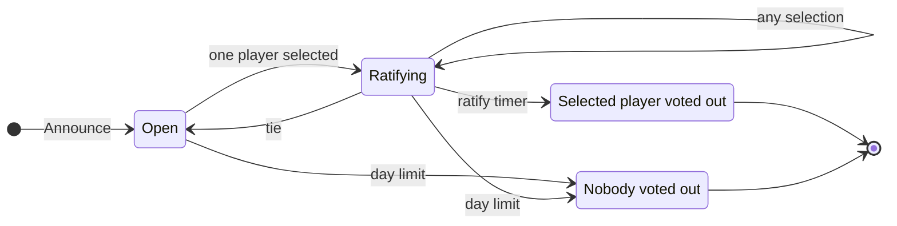

# ADR-0006: Players talk by day

**Status:** Accepted
**Date:** 2026-10-11
**Deciders:** Bill McNeill
**Depends on:** [ADR-0002](0002-actors-perceive-think-and-act.md),
[ADR-0003](0003-the-model-player.md),
[ADR-0005](0005-actors-talk-by-sending-messages-alone.md)
**Amends:** [ADR-0003](0003-the-model-player.md)

## Context

In the model-played variant of Werewolf, every player is a language model
that makes one selection per phase with one forced tool call
([ADR-0003](0003-the-model-player.md)). The environment opens each phase by
sending each awake player an `Announce { seq, observation }`, in which
`observation` is what the player may see of the state, takes the
first `Select { seq, from, target }` from each, and ends the phase once
everyone awake has selected or at the phase limit
([ADR-0005](0005-actors-talk-by-sending-messages-alone.md)). Nobody talks.
A player's history holds its own selections, the phases and the deaths,
and nothing about anyone else.

Talk is the last thing standing between the project and 0.2.0. What makes
it hard is that it must be asynchronous and spontaneous: no turn-taking,
ever. A model decides *whether* to speak and *what* to say, and the timing
of the game decides *when*. If a result that depends on turn-taking is to
be reproduced, the turn-taking goes in a behavior, not in the framework or
the game.

Three things about the existing pieces bear on the design.

- **A model never decides when on its own.** It answers when it is called.
  Whatever wakes a player's think loop is what decides when it may speak.
- **The think loop takes its messages one at a time,** and the model player
  calls the model once for each. A broadcast utterance wakes every other
  player, and each of those calls may produce an utterance of its own. If
  utterances arrive faster than the model answers, the queue grows without
  bound, and every call is made from an older history than the last.
- **A response with no tool call is a failure** (ADR-0003). Staying silent
  needs to be something the model can say, or it cannot be told apart from
  a broken model.

Players cooperate with the game: they follow the rules as well as they can,
and it is each player's responsibility to know which phase is active and to
act accordingly.

## Decision

**By day, living players speak to one another directly, whenever they
choose, and select whenever they choose. The environment does not hear the
talk. It keeps the selections, announces each tentative decision, and ends
the day when a tentative decision has stood unchanged for the ratify limit,
or at the day limit with nobody voted out. The night is unchanged.**

### The day



| Transition | The environment |
|---|---|
| day opens | sends each living player an `Announce` with the day limit |
| Open → Ratifying | sends `Tentative(selected)` with the ratify limit, starts the ratify timer |
| Ratifying → Ratifying, same player selected | restarts the ratify timer |
| Ratifying → Ratifying, another player selected | sends `Tentative(selected)` with the ratify limit, restarts the timer |
| Ratifying → Open | sends `Tentative(nobody)` |
| ratify timer fires | votes the selected player out, and logs `Voted` |
| day limit | votes nobody out, whatever is standing, and logs `Voted` |

1. The environment opens the day with an `Announce` to every living player,
   carrying the day limit.
2. A player may select at any time while the day is open, and as often as
   it likes. Its latest selection is its vote. Each selection goes to the
   environment and to every other living player.
3. A player may speak at any time while the day is open. An utterance goes
   to every other living player, and not to the environment, which does
   nothing with speech.
4. The environment keeps the votes. Whenever they produce a different
   tentative decision than the one standing, it sends every living player a
   `Tentative` naming the selected player, or nobody, with the ratify limit.
   A tentative decision is the day's vote applied to the votes so far: the
   votes select a player when it alone has the most of them, since a tie
   selects nobody (`NoTieBreak`).
5. While a player is selected, the environment runs the ratify timer. Any
   selection restarts it, whether it is a player's first or a change, and
   whether or not it changes who is selected. Speech never restarts it, so
   nobody can hold the day open by talking.
6. The day ends when the ratify timer fires, and the selected player is
   voted out; or at the day limit, whatever is standing, and nobody is
   voted out.

The function that finds the players with the most votes, `leaders`, is
renamed `most_votes`: they are the players with the most votes, not
players in charge of anything, and with a tie there are several of them
while the vote selects nobody.

The first selection of a day already selects a player, so ratifying
begins at once. That is intended: every later vote restarts the timer, so
the day ends one ratify limit after the votes stop moving. It is the same
quiet period the night negotiation was designed around.

A werewolf can keep restarting the timer by changing its vote, to run the
day out to its limit with nobody voted out. The votes are public, so a
player who does this is seen doing it. No rule forbids it.

The day no longer ends when everyone has selected, since anyone may still
change their vote.

### Durations are announced

A player holds no state but its history, so the facts about time it needs
are in its messages. `Announce` carries the phase's limit, by night as well
as by day. `Tentative` carries the ratify limit. Neither carries a
deadline: the limit is a rule of the game, and a player that wants to know
how much time is left can see when its messages arrived.

### Messages

`werewolf::Message` becomes:

| Message | From | To | Carries |
|---|---|---|---|
| `Announce` | environment | every living player, awake in the phase or not | `seq`, `n`, `view`, `limit` |
| `Select` | a player | the environment, and by day every other living player | `seq`, `from`, `n`, `target` |
| `Say` | a player | every other living player, by day | `seq`, `from`, `n`, `text` |
| `Tentative` | environment | every living player, by day | `seq`, `n`, `target: Option<PlayerId>`, `ratify` |
| `EndPhase` | environment | itself | `seq` |

The struct that `Announce` carries, what a player may see of the state, is
renamed from `Observation` to `View`: in the terms of reinforcement
learning it is the player's partial view of the state, and the name
`Observation` goes to the log (below).

- **`seq` is the phase,** as the sender knows it: for the environment, the
  phase it is in; for a player, the latest phase it was announced. An
  utterance is tagged with the phase in which its speaker said it.
- **`(from, n)` names a message.** Every actor numbers what it sends, from
  1: a player its utterances and selections together, the environment its
  announcements and tentative decisions. The pair is unique in an episode
  without a global counter. It is not called `seq`, which already means the
  phase. A message sent to several actors at once has one number; the
  environment's `Announce`, which shows each player a different view, is a
  message of its own to each. The environment's reminders to itself, such
  as `EndPhase`, are not numbered.

The environment is not sent speech, and does not relay anything a player
says. This reverses the earlier plan for all speech to go through the
environment. A player sends only to the living players its latest
view shows; one that has died since is skipped by `send`, as
before.

By night the rules do not change: selections go to the environment alone,
the first one counts, one from a player asleep is dropped, and the phase
ends when everyone awake has selected or at its limit. What changes is who
is told. Every living player is announced every phase, awake in it or not,
because nothing else marks a phase's end: `EndPhase` and `Ratify` are the
environment's reminders to itself, and a player cannot know the day has
ended unless it is told. The announcement is what lets a player know which
phase is active, which is its responsibility. `werewolf::awake(me, view)`
says whether a player acts in the phase its view shows, by the one rule
`State::awake()` goes by, so the environment and the players cannot
disagree about who sleeps.

### What wakes a model player

A model player announced a phase it is not awake in records the phase,
remembers the announcement, and makes no call. By night a villager is
woken by nothing: a `Say`, `Select` or `Tentative` that arrives late is
remembered and observed without a call, a reminder it set by day no longer
counts, and a wake-up left waiting from the day finds it asleep. No request
is built and no failure is logged for a phase slept through.

By night, a model player awake in it is woken once, by its `Announce`, and
makes one forced `select` call, as it does today.

By day, it is woken by every message it receives: an `Announce`, a `Say`, a
`Select` or a `Tentative`. Wake-ups are debounced. The perceive loop adds
each message to the history, and hands the think loop a wake-up only if one
is not already waiting. The think loop, woken, takes the history as it
stands and calls the model once. A player therefore has at most one call in
progress and one waiting, however fast the talk comes, and each call is made
from everything the player had heard when it began.

A model may also ask to be woken later (below). That reminder is a wake-up
like any other, set with `Context::think_after`. Timers cannot be
cancelled, so each reminder is numbered, and only the latest one set counts.
A reminder for a phase that has ended is ignored.

The debouncing lives in the model player, not in `free-agent`.

### One prompt, three tools

By day, each call is one request, built as ADR-0003 builds it: the system
prompt, then the history told as a story and where the game stands. It
offers three tools, sets `tool_choice` to require a call, and allows
parallel calls:

- **`speak(text)`:** say `text` to every other living player.
- **`select(target)`:** vote for `target`, one of the day's candidates.
- **`wait(seconds)`:** say nothing now, and be woken after `seconds`
  unless something wakes the player sooner. `seconds` is a whole number
  from 1 to the day limit.

The calls in a response are carried out in the order the model made them,
so a model can speak and vote in one answer. A response that fails as
ADR-0003 judges a selection, a call to an unknown tool, or arguments that do
not parse, fails as a whole, and nothing in it is carried out.

`wait` makes silence something the model says, so it is not mistaken for a
failure. It also gives the model a say over timing, beyond reacting:
without it, a day in which everyone falls silent wakes nobody again, and
runs out its limit.

When to speak and what to say are decided together, by the one prompt.
Whether separate models should make the two decisions is left until this
one has been seen to play.

### Utterances from an old phase are withheld

A call may begin in one phase and end in the next. Before sending anything
a response asks for, the player checks that the phase it was announced most
recently is still the one the call began in. If not, it sends nothing from
that response and logs it as withheld. This is the player following the
rules as well as it can; a message it sends just before the phase ends may
still arrive after, and the receiver deals with that.

A receiver remembers every message it is sent, whatever the phase. An
utterance that arrives late, such as day talk heard by a werewolf at night,
is told in the phase it is tagged with, not as something said now. A late
selection is dropped by the environment by its `seq`, as today.

### The story grows talk

The player's history now holds what others said and how they voted, and
the `Narrator`'s account for a player tells it:

- "player3 says, “…”"
- "player4 votes for player2."
- "player2 will be voted out in 20 seconds unless the votes change." /
  "Nobody is about to be voted out."
- "During day 2, player4 said, “…”" for an utterance heard after its
  phase.
- "You sleep." after the phase line of a phase the player sleeps through,
  so a villager learns of a death when the night opens rather than at the
  next day.

Where the game stands, at the end of the request, gives the phase and its
limit, and what the player may do: by day, speak, vote, or wait. The
omniscient account on standard output tells the same talk.

The history is still only appended to, apart from the placement of late
messages that ADR-0003 already allowed, so prompt prefix caching still
works.

### Logging

The log speaks the language of reinforcement learning. Every message an
actor sends to others is an **action** of its sender, logged whole, once, by
the sender. Every message an actor receives is an **observation** of its
receiver, logged by the receiver as a receipt that names the message and
does not repeat it. The environment is an actor like the players: its
announcements and tentative decisions are its actions, and the players log
observing them.

`Entry` becomes:

```rust
enum Entry {
    Start { .. },
    Configuration(..),
    Action { from, n, to: HashSet<ActorId>, message: Message, seen: Option<usize> },
    Observation { by, from, n, seq },
    Withheld { from, message, seen: Option<usize> },
    Failed { .. },
    Hunted { seq, hunt },
    Voted { seq, out: Option<PlayerId>, by: Ending },
    End { .. },
}
```

- **`Action`:** logged by an actor for each message it sends to others,
  with everyone it was sent to. `seen` is the number of history entries the
  model was shown when it made the call that produced the message, and
  `None` for anything not made by a model.
- **`Observation`:** logged by an actor for each message it receives from
  another. `seq` is the phase the receiver was in when the message
  arrived: for the environment, the phase it is in; for a player, the
  latest phase it was announced. Set beside the `seq` of the `Action` it
  names, it shows a message that arrived in a later phase than it was sent
  in.
- **`Voted`:** logged by the environment when a day ends: the day's `seq`,
  who was voted out if anyone, and how the day ended, `Ratified` or
  `DayLimit`. It is the day's counterpart to `Hunted`, and is logged even
  when nobody is voted out, so that a day ended by its limit is told apart
  from one that ratified, and every day's end is in the log.
- **`Withheld`:** logged by a player for each message it did not send
  because its phase had ended. It was never sent, so it has no number.

The kinds of action are the variants of `werewolf::Message`; no second enum
repeats them. `Sent` and `Received` go, and with them the environment's
logging of every message to or from a player: each actor logs its own
side. Self-directed reminders, such as `EndPhase`, are neither actions nor
observations, and are not logged.

Every entry that happens during a phase says which phase in a field of its
own: an `Action` and a `Withheld` by their message's `seq`, and an
`Observation`, `Voted` and `Failed` by theirs. `Hunted` gains a `seq` for the
same reason, as `Hunted { seq, hunt }`. Nothing about phases depends on the order in which
entries reach the log, or on their timestamps, so the log can be split or
merged without losing them.

The words *action* and *observation* belong to the log, which pairs them
for whoever reads it afterward. The messages themselves keep their own
names, and nothing at run time pairs an observation with an action.

With `seen` and the `Observation` entries, the log says, for every
utterance, what its speaker had heard when it began and what it had heard
by the time it spoke, which is what is needed to measure speaking from a
stale context afterward. With an `Observation` for every receipt, it also
gives every latency between actors.

A player's history is no longer a list of its own log entries, as ADR-0003
had it, since its log entries for what it heard name messages without
holding them. The history holds the messages themselves, each stamped when
the player received it, and its own actions. What a model was shown can
still be reconstructed from the log, by joining each `Observation` to the
`Action` it names.

### Configuration

The ratify limit is an absolute duration, `ratify_limit`, in the `[phases]`
table and on the command line as `--ratify-limit`, with a default in the
code of 20 seconds. Settling the configuration is an error, before any game
begins, if `ratify_limit` is longer than `day_limit`; the error names both.

The `Configuration` entry records the ratify limit with the others.

The ratify limit belongs to the model-played variant. In `Rules` it is
optional: with no ratify limit, the day is run as it is today, the first
selection counts, and the day ends when everyone has selected or at its
limit. The uniform-random variant has none, so its games, which are the
random baseline, play exactly as before.

### The probe

[ADR-0004](0004-the-model-is-asked-to-select-before-a-game.md)'s probe asks
for one selection. A day's request has a different shape, three tools and
parallel calls allowed, and a server may reject that shape while accepting
the other. The probe therefore makes a second request, shaped as a day's,
and requires a well-formed call to one of the three tools.

## Alternatives considered

### Speech through the environment

Have players send utterances to the environment, which relays them, as was
once planned. Rejected: the environment does nothing with speech, relaying
adds a hop to every utterance, and its log would hold talk it has no use
for.

### Speech restarts the ratify timer

So that an argument in progress is not cut off by the vote. Rejected: it
would let anyone hold the day open by talking. An argument has to be made
before the votes settle.

### A ratify limit as a share of the day

Ten percent of the day, say. Rejected for an absolute duration: what the
limit has to be longer than is a model's answer to a `Tentative`, which does
not grow with the day.

### Players work out the tentative decision themselves

Every selection is public, so a player could tally them. Rejected: a model
does not reliably tell a tie from a tally, and the environment's
announcement fixes when ratifying began. A separate message for a decision
withdrawn was also considered; `Tentative` naming nobody does the same.

### One call per message

Keep the think loop calling the model for every message handed to it.
Rejected for the backlog it builds, described above.

### Silence as no tool call

Let a response without a tool call mean the player says nothing. Rejected:
it cannot be told apart from a model that failed, and gives the model no way
to ask to be woken later.

### Separate models for when and what

A cheap model that decides whether to speak, in front of the one that
decides what to say. Not rejected, but not first: the single prompt is the
simplest thing that could work, and other ways of deciding when to speak are
for after it has been seen to play.

### Streaming

Send an utterance in chunks as the model produces it. Deferred: streaming
the arguments of a tool call is awkward, and whole utterances are enough to
see how players decide when to speak.

### The hammer

End the day at once when a majority of the living vote for one player.
Not chosen: the ratify period lets anyone change their vote after a
decision appears, which a hammer would not.

## Consequences

- **Players talk, and choose when.** Nothing in the game or the framework
  takes turns.
- **Players can see each other's votes,** by day, as they are made.
- **A day lasts at least the ratify limit** after its last vote, and no
  longer than the day limit.
- **The cost of a day grows with the talk.** Each utterance wakes every
  other player. Debouncing bounds it at one call in progress per player, so
  a day costs at most about as many calls per player as the day limit
  divided by the time a call takes.
- **A player may speak from a context that is out of date** by the time it
  speaks. That is allowed, and the log says when it happened.
- **The log is written by everyone,** in actions and observations. Each
  actor logs what it sends and what it receives, as well as its failures.
  Reading what was said to whom means joining observations to actions.
- **Every living player is announced every phase,** so a player knows when
  the day has ended, which only the environment's timer decides. A player
  asleep in the phase makes no call and is woken by nothing, and the log
  holds an announcement to, and an observation by, every living player each
  phase.
- **The uniform-random variant plays as before,** but its log changes shape
  with everyone else's: `Sent` and `Received` become actions and
  observations, and every living player is announced every phase.
- **Startup makes one more request** to the model, for the day's probe.
- **ADR-0003 is amended:** talk is no longer deferred, a player's account
  holds what others said and how they voted, a player's history holds
  messages rather than its own log entries, `Observation` is renamed
  `View`, and by day a model player has three tools instead of one.

## Deliberately deferred

1. **Streaming utterances.**
2. **Other ways of deciding when to speak,** such as a separate model or a
   cheap gate in front of the model call.
3. **Abandoning a call in progress** when something new is heard.
4. **Talk by night,** and werewolves seeing each other's selections.
5. **Speech to some players and not others.**
6. **The hammer.**
