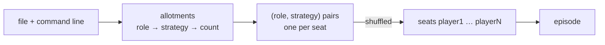

# ADR-0008: Werewolf is one game whose players are dealt strategies

**Status:** Accepted, amended by [ADR-0010](0010-avalon-is-a-second-game-built-by-copying-werewolf.md)
**Date:** 2026-10-12
**Deciders:** Bill McNeill
**Depends on:** [ADR-0001](0001-games-and-variants-are-modules-and-subcommands.md),
[ADR-0003](0003-the-model-player.md),
[ADR-0004](0004-the-model-is-asked-to-select-before-a-game.md),
[ADR-0006](0006-players-talk-by-day.md),
[ADR-0007](0007-a-tool-call-is-required-where-the-model-allows-it.md),
[ADR-0009](0009-only-a-change-of-decision-restarts-the-ratify-timer.md)
**Amends:** [ADR-0001](0001-games-and-variants-are-modules-and-subcommands.md),
[ADR-0006](0006-players-talk-by-day.md)

## Context

[ADR-0001](0001-games-and-variants-are-modules-and-subcommands.md) made each
way of playing Werewolf a *variant*: a module under `werewolf/` and a
subcommand under `social-deduction werewolf`. There are two:

- `werewolf uniform-random`: every player picks uniformly at random among
  its candidates the moment it is announced a phase it is awake in. It
  takes role counts and phase limits on the command line and needs no file.
  Its day is not ratified: each player's first vote is final, and the day
  ends when everyone has voted or at the day limit.
- `werewolf llm`: every player is a language model, set up by a TOML file
  that names one model for the whole table, a system prompt template for
  each role, and a persona for each seat that has one. Its day is ratified
  ([ADR-0006](0006-players-talk-by-day.md)), with a ratify limit of 20
  seconds unless the file or command line says otherwise.

Each variant gives every player the same behavior, and the model-played
variant gives every player the same model. The experiments the project is
built for need tables where players differ: a team of random werewolves
against a village of model players, two werewolves with different prompts,
or a smarter model against a weaker one. Some models are clearly better at
the game than others, and watching them play each other is interesting in
its own right. None of that can be expressed today.

Most of the pieces a mixed table needs already exist:

- **One message enum.** ADR-0001 gave every variant one `werewolf::Message`.
  The random player and the model player already speak the same protocol to
  the same environment, `announced::Environment`.
- **One environment.** Both variants run `announced::init`. They differ only
  in their `Rules` (the ratify limit and the variation's name) and in
  whether the log gets an `Entry::Configuration`.
- **Players are boxed and self-contained.** A player's behavior is built by
  a boxed `Builder`, and its think loop, if it has one, is a boxed
  `dyn Think`. A random player has no think loop, a model player has one,
  and `werewolf::thinking_episode` already takes each player's think loop
  as an `Option`. Each model player is already built with its own handle to
  the model client, model id, tool choice and context window, so nothing in
  it assumes the others share them.

Three things stand in the way:

- **An episode holds one actor type.** `Episode<B>` is generic over one
  `B: Behavior`, and each variant has its own `Actor` enum, its environment
  and its kind of player.
- **A random player's day vote is private.** `uniform_random::Player`
  sends every selection to the environment alone. By day the rules
  ([ADR-0006](0006-players-talk-by-day.md)) send a selection to the
  environment and every other living player, so that votes are public.
  Model players at a mixed table would never hear a random player vote.
- **The variants play different days.** One table has one set of rules.

The project's standing rule against building generality before it is
needed still holds. Nothing here lets a crate outside `social-deduction`
add a player.

## Decision

**Werewolf is one game, played by one subcommand. A configuration file
defines named *models* and named *strategies*, each strategy a *policy*
with its parameters, a prompted one naming its model, and allots each
role's seats among the strategies. The roles are dealt at random, and each
role's strategies are dealt at random among the seats that role gets.
Personas go away.**

### Terms

- A **policy** is a kind of player, written in Rust: how a player turns
  what it observes into what it does. There are two, `random` and
  `prompted`, which are the uniform-random player and the model player
  renamed.
- A **strategy** is a policy with its parameters, named in the file. Two
  strategies may share a policy and differ in their parameters, such as two
  `prompted` strategies with different system prompts or different models.
- An **allotment** says, for one role, how many of its seats play each
  strategy.

"Policy" is used as reinforcement learning uses it. It is not called a
behavior, since `free_agent::Behavior` is the trait every actor
implements.

### The configuration file

```toml
ratify_limit = "20s"          # optional; see "The day" below

[models.qwen]                 # a model, named for the strategies to use
base_url = "http://localhost:1234/v1"
id = "qwen2.5-7b-instruct"

[models.claude]
base_url = "https://api.anthropic.com/v1"
id = "claude-sonnet-4-5"

[text]
rules = """Werewolf is a game of hidden roles. …"""

[strategies.cautious]
policy = "prompted"
model = "qwen"
system = """{{ rules }}

You are {{ name }}, a {{ role }}. You are slow to accuse."""

[strategies.bold]
policy = "prompted"
model = "claude"
system = """{{ rules }}

You are {{ name }}, a {{ role }}. You trust your instincts and say so."""

[roles.werewolf.strategies]   # a mixed role: one random wolf, one bold one
random = 1
bold = 1

[roles.villager]              # a uniform role: three cautious villagers
count = 3
strategy = "cautious"

[roles.seer]                  # count and strategy from the defaults
[roles.doctor]
count = 0
```

**Models.** Each `[models.<name>]` table describes one model and how to
reach it, with the keys the `[model]` table has today: `base_url`, `id`,
`api_key_env`, `request_timeout` and `context_window`, and the same
defaults and rules, but for the command line, which no longer has a say: a
model's context window comes from its table, otherwise from the provider's
listing, otherwise from `src/models.toml`, otherwise from the code. The
`[model]` table goes away. Models may share a
provider or not; each is its own client, with its own key read from its own
variable.

**Strategies.** Each `[strategies.<name>]` table names its `policy` and
gives that policy's parameters, and only those: an unknown key is an error,
as it is anywhere in the file.

- `random` takes no parameters.
- `prompted` takes `system`, its system prompt template, and `model`, the
  name of one of the file's models. Both are required, but `model` may be
  left out when the file defines exactly one model. A model name that is
  not defined is an error naming the strategy.

A prompted strategy's template is rendered with `minijinja` as
[ADR-0001](0001-games-and-variants-are-modules-and-subcommands.md)
describes, with strict undefined variables. Its variables are `name` and
`role`, the seat and the role dealt to it, and every `[text]` block. A
strategy may still read differently by role through
``.

A strategy named `random`, with the `random` policy, is always defined, so
that a table of random players needs no `[strategies]` at all. Defining a
strategy named `random` in the file is an error.

**Allotments.** Each role is allotted in one of three ways, from the most
specific to the least:

1. `[roles.<role>.strategies]` maps strategy names to seat counts. The
   counts add up to the role's count.
2. `[roles.<role>] strategy = "<name>"` gives every seat of the role one
   strategy.
3. A top-level `strategy = "<name>"` gives every seat of every role not
   allotted otherwise one strategy. Without it, the default is `random`.

A role's count comes, as now, from the command line if given there,
otherwise from the file's `count`, otherwise from the code. With a
`strategies` table, the counts in the table are also a count from the file:
if `count` is written too, or the command line gives one, and it disagrees
with the table's sum, it is an error naming the role and both numbers. A
role allotted any other way takes whatever count wins. A strategy name that
is not defined is an error naming the role. A strategy defined and never
allotted is not an error.

The `[prompt]` table and the `[roles.<role>] system` key go away. Their job
is done by strategies.

**Personas go away.** The `[personas]` table and the `persona` template
variable are removed. A persona was a way to make one player's prompt
differ from the rest; a named strategy with its own prompt does the same,
and is explicit about which seats get it. The one thing personas did that
strategies do not is stay independent of role, since a persona belonged to
a seat and roles are dealt at random. A strategy allotted to every role
gets the same effect, should an experiment need it.

### Models in play

A model is **in play** when a prompted strategy that names it is dealt to at
least one seat. Only models in play are set up: before any actor is built,
each one's key is read, its listing fetched, its context window settled,
and the probe run ([ADR-0004](0004-the-model-is-asked-to-select-before-a-game.md),
[ADR-0007](0007-a-tool-call-is-required-where-the-model-allows-it.md)), so
that a missing key, a model that is not served, a window too small, or a
model that does not play fails at launch, naming the model. A model the
file defines but no dealt strategy uses is not contacted, and its key need
not be set.

Each model in play keeps its own settled tool choice and context window.
The context window is checked against the largest request any prompted
strategy using that model could make, as it is checked against the one
model today. Models in play are probed one at a time, since a local server
loads each model it is asked for.

Each prompted player is built with its strategy's model: the model's
client, id, tool choice and context window.

### The deal



The allotments make a list of (role, strategy) pairs, one per seat. The
list is shuffled and dealt to the seats `player1` onward. Dealing pairs
rather than roles keeps the deal random in both respects: a seat is as
likely as any other to get each role, and each seat of a role as likely as
any other to get each of that role's strategies. Each prompted player's
system prompt is rendered for its seat, its role and its strategy. As now,
every prompt a game could call for is rendered before any actor is built,
so a broken template fails at startup: every seat, for every (role,
strategy) pair at the table whose strategy is `prompted`.

### The day

The ratify limit becomes a plain `Duration`. **Zero means the day is not
ratified**, which is today's rule for `uniform-random`: each player's first
vote is final, and the day ends when everyone awake has voted, or at the day
limit; the player with the most votes is voted out, and a tie votes out
nobody (`NoTieBreak`). Any other value ratifies the day as ADR-0006
describes, as amended by
[ADR-0009](0009-only-a-change-of-decision-restarts-the-ratify-timer.md):
the timer restarts only when the tentative decision changes, and a vote may
be retracted. Where ADR-0009 speaks of "a day with no ratify limit", this
decision means a ratify limit of zero.

The default is zero, in the code, for every game. There is no principled
non-zero value, so a file or the command line (`--ratify-limit`) chooses
one. The 20-second default of the model-played variant goes away; the
example files say `20s` themselves. The rule that the ratify limit may not
be longer than the day limit stays.

Zero is not ratification with a timer of zero. The first selection of a
day changes the tentative decision from nobody to a player, which starts
the timer under ADR-0006 and ADR-0009 alike, so a zero timer would vote out
whoever got the first vote.

At zero, a prompted player's first vote is final, so it should talk before
it votes. Its prompt is where it learns that. It is offered `speak`,
`select` and `wait`, and not `retract`, as ADR-0009 has it for a day with
no ratify limit. A second `select` is sent and does not count.

The probe ([ADR-0004](0004-the-model-is-asked-to-select-before-a-game.md),
[ADR-0009](0009-only-a-change-of-decision-restarts-the-ratify-timer.md))
asks each model as by day with the tools of a ratified day whatever the
ratify limit, so a model's fitness to play does not depend on the file's
choice of limit.

### The random player's votes are public

A random player sends its selection to `werewolf::receivers(...)`, as the
prompted player does: by night to the environment, by day to the
environment and every other living player. Nothing else about it changes.
It still answers its announcement at once, never retracts
([ADR-0009](0009-only-a-change-of-decision-restarts-the-ratify-timer.md)),
and observes everything else.

This decision adds nothing to `werewolf::Message`; ADR-0009 adds `Retract`.
`Wake` and `Remind` stay the prompted player's messages to itself, as
ADR-0001 allows.

### One actor enum, one game

The two variants' `Actor` enums become one:

```rust
pub enum Actor {
    Environment(announced::Environment),
    Random(random::Player),
    Prompted(prompted::Player),
    #[cfg(test)]
    Puppet(tests::Puppet),
}
```

One `werewolf::game` builds every episode: the environment, and for each
seat the builder and optional think loop of its strategy's policy.
Putting players behind `Box<dyn Behavior>`, with a blanket implementation
in `free_agent`, was not chosen (below).

### Layout

```
apps/social-deduction/
  examples/
    werewolf/             # example configuration files, formerly werewolf/llm/
      random.toml         # every role random
      prompted.toml       # one local Qwen model, one simple prompted strategy for everyone
  src/
    werewolf.rs           # the rules, messages, log, Actor, and game
    werewolf/
      config.rs           # the file, the command line overrides, the settings, the deal
      announced.rs        # the environment
      random.rs           # the random policy, formerly uniform_random.rs
      prompted.rs         # the prompted policy, formerly llm.rs, less its configuration
      report.rs           # the Narrator
```

There are two examples. `random.toml` allots every role to the `random`
strategy, with nothing else, and plays the same game as no file at all; it
shows the shape of a file with no models. `prompted.toml` is today's
`minimal.toml` converted: one `[models.qwen]` table for a Qwen model on a
local LM Studio server, with a comment saying that the model id and base
URL will likely need changing to whatever the reader has running, and one
prompted strategy with the same simple prompt, a rules text block and one
conditional for werewolves, allotted to everyone by the top-level
`strategy`. `minimal.toml` and `personas.toml` are deleted. The examples
stay small on purpose: mixed tables and several models are shown in the
README, not in a file a reader is likely to run first. The
configuration moves out of the model player's module, since it now
configures every game. ADR-0001's rule that a game is a module stays; its
rule that each variant is a module and a subcommand goes. A future game
with genuinely different rules, such as a variation in another crate, would
be a new decision.

### The command line

```sh
social-deduction werewolf [CONFIG] [--werewolves N] [--villagers N] [--doctors N] [--seers N] [--night-limit D] [--day-limit D] [--ratify-limit D] [--log | --no-log]
```

`werewolf` takes one optional file. Without one, every role is played by
the `random` strategy with the default counts and limits, so
`social-deduction werewolf` plays 0.1.0's game in moments, exactly as
`werewolf uniform-random` does today.

What stays on the command line is what applies to every game, whatever its
strategies: the role counts, the phase limits, the ratify limit and the
logging flags. A role count given there for a role allotted by a
`strategies` table must agree with the table, as above.

**The model options go:** `--model-base-url`, `--model-id` and
`--context-window`. They existed for trying another model without editing
the file, when a file had one model for the whole table. With named models,
an option that replaces "the" model has nothing definite to replace, and a
model is changed by editing its `[models.<name>]` table, or by keeping a
second file. `werewolf uniform-random` already took only the options that
stay, so its command line carries over unchanged but for the subcommand's
name.

### The log

- `Entry::Start` loses `variation`, which no longer names anything, and
  gains `strategies`: each player's strategy name, beside its role, since
  the strategy is part of the deal. Its `ratify_limit` is a `Duration`, and
  zero when the day is not ratified.
- `Entry::Configuration` is logged in every game, right after the deal. It
  records the settings as they took effect; every strategy as written, with
  its policy and parameters; the allotments; each model in play, keyed by
  name, with its base URL, id, request timeout, key variable, settled tool
  choice and context window; and each prompted player's rendered system
  prompt. Models not in play are not recorded. `personas` is removed.
- The Narrator's opening heading names the table by its strategies rather
  than by a variation, and tells each player's strategy with its role. The
  model a player uses is read from its strategy in the configuration.

## Alternatives considered

### Behavior per seat

A file could give each seat, `player1` onward, its own behavior. Roles are
dealt at random, so a seat-keyed behavior would land on a different role
every game: "random werewolves against model villagers" could not be
written. The experiments compare roles and teams, so the allotment is per
role.

### One policy per role, without strategies

The first form of this decision allotted policies, not strategies, to
roles, with each role's prompt in `[roles.<role>]`. It cannot express two
prompted werewolves with different prompts or models. Naming a policy
together with its parameters, and allotting the name, can.

### Keep personas

Personas could stay, keyed by seat, as a variable any prompted strategy's
template may use. They would be a second, overlapping way of making one
player's prompt differ from another's, and the only part of the
configuration keyed by seat. Named strategies cover what they were for.

### One model for the whole table

Keeping `[model]` and a single model would be simpler, but the comparison
of models against one another is one of the things worth watching, and
every model player is already built with its own model handle.

### A default `[model]` beside named `[models]`

A file could keep `[model]` as the model every strategy uses unless it
names another. That gives two ways to say the same thing. Instead, a
strategy may leave `model` out exactly when there is only one model to
mean.

### Keep the variants, add a mixed one

A third subcommand for mixed tables would leave two subcommands that are
special cases of it, three sets of arguments to keep in step, and the same
merge to do later.

### Players behind `Box<dyn Behavior>`

`Behavior` is object-safe, so a blanket
`impl Behavior for Box<dyn Behavior<Message = M, Log = L>>` in `free_agent`
would let an episode hold players of any type, including ones from other
crates. Nothing needs that yet. The enum is closed, in one crate, and costs
nothing in the framework.

### A literal zero-second ratify timer

Rejected as above: it votes out whoever gets the first vote.

### A majority hammer at zero

Zero could instead mean that the latest vote counts and the day ends the
moment a strict majority votes for one player. Random players rarely reach
a majority by chance, so an all-random game would mostly run every day to
its limit and vote out nobody, which changes 0.1.0's baseline. A hammer may
still come, as a rule of its own.

## Consequences

- A table can mix any strategies and any models in any role, which is what
  the experiments need.
- With no file, the game, its rules and its log's content are 0.1.0's, but
  for the renamed and added fields, so the random baseline is unchanged.
- **Breaking:** `werewolf uniform-random` and `werewolf llm` are gone, and
  existing configuration files must move their model into `[models]`, their
  templates into strategies, and any personas into strategies of their own.
  The project is pre-1.0, and the only files are its examples:
  they become `random.toml` and `prompted.toml`, and `minimal.toml` and
  `personas.toml` are deleted.
- **Behavior change:** a model-played game whose file and command line say
  nothing about ratification is no longer ratified.
- Launch takes longer with several models in play, since each is probed in
  turn, and fails if any one of them does not play.
- Random votes now reach every living player by day. In an all-random game
  nobody listens, so only the log grows: one observation per living player
  per vote.
- `RATIFY_LIMIT` and `llm::rules()` go away, and `Rules::variation` with
  them.
- **Breaking:** the model options are gone from the command line, and with
  them `llm::Overrides`' `ModelOverrides`. The `models` subcommand, which
  plays no game, is unaffected.
- `tests/binary.rs` and the command line tests are rewritten for one
  subcommand. The example files are still loaded and rendered by a test.

## Deliberately deferred

- Any way to choose or override a model from the command line.
- More policies, such as a scripted one, which would be a third arm of the
  enum and a third `policy` value.
- A majority hammer.
- Players or games from crates outside `social-deduction`.
