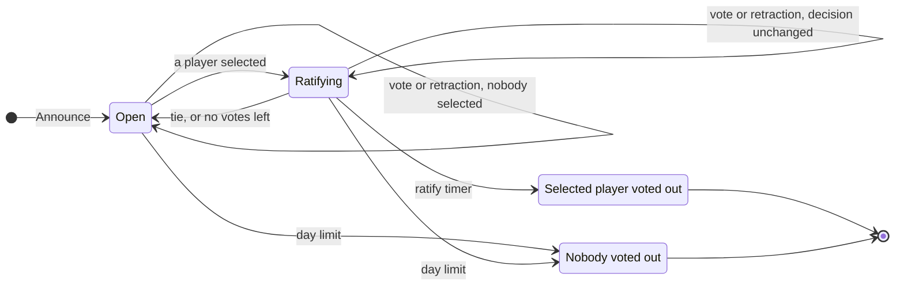

# ADR-0009: Only a change of decision restarts the ratify timer, and a vote may be retracted

**Status:** Accepted
**Date:** 2026-10-12
**Deciders:** Bill McNeill
**Depends on:** [ADR-0003](0003-the-model-player.md),
[ADR-0006](0006-players-talk-by-day.md)
**Amends:** [ADR-0006](0006-players-talk-by-day.md)

## Context

By day, a player may select whenever it likes, as often as it likes, and its
latest selection is its vote ([ADR-0006](0006-players-talk-by-day.md)). The
environment keeps the votes. Whenever they produce a different *tentative
decision*, the player they select or nobody, it sends every living player a
`Tentative` carrying the ratify limit. While a player is selected, the
environment runs the *ratify timer*. The day ends when the timer fires, and
the selected player is voted out, or at the day limit, and nobody is.

ADR-0006 restarts the ratify timer on every selection that counts: a
player's first vote, a change of vote, or the same vote cast again, whether
or not it changes who is selected. The intent was for the day to end one
ratify limit after the votes stop moving, like the night's quiet period.

Two problems have come out of that rule.

- **A player cannot know when the day will end.** A `Tentative` is sent
  only when the decision changes, but the timer restarts on every vote. A
  vote that leaves the decision as it was moves the deadline and tells
  nobody. A player sees every vote, so it could work the deadline out, but
  only by keeping track of every selection itself, which is exactly what
  ADR-0006 rejected asking a model to do.
- **Any one player can hold the day open.** Voting for the same player
  again, once every ratify limit, runs the day out to its limit with nobody
  voted out. Players can see who is doing it, but it costs nothing, and it
  needs no other player's help.

A player also has no way to take a vote back. Once it has voted, it can
move its vote to another player but cannot go back to being undecided.
Someone who voted early and has been talked out of it has to pick another
target or leave the vote standing.

## Decision

**The ratify timer restarts only when the tentative decision changes. A
player may retract its vote by day, and a retraction is handled like a
change of vote.**

### The timer follows the decision

The environment starts the ratify timer whenever the tentative decision
changes to a player, from nobody or from another player, and stops it
whenever the decision changes to nobody. A selection or retraction that
leaves the decision as it was does nothing to the timer, whether it adds a
vote for the selected player, takes one away, or moves a vote between other
players.

A `Tentative` is sent exactly when the decision changes, so **every restart
of the timer is announced.** The day ends one ratify limit after the latest
`Tentative` naming a player, unless another `Tentative` follows first. A
player can see the deadline from its own history without counting votes.

The day now ends one ratify limit after the *decision* stops moving, rather
than after the *votes* do.

### Retracting a vote

A player retracts its vote, and so is undecided again, by sending a
`Retract`:

| Message | From | To | Carries |
|---|---|---|---|
| `Retract` | a player | the environment, and every other living player | `seq`, `from`, `n` |

Like a `Select`, it is numbered in the player's own series, and it is
tagged with the phase in which the player sent it. By day it goes where a
selection goes, so votes and their retractions are both public.

A retraction counts only where a vote can change: in a day with a ratify
limit, in the phase underway, from a player awake in it, and when that
player has a vote standing. Then the environment removes the player's vote,
works out the tentative decision again, and does what any other change of
vote would do. Anywhere else a retraction does not count, as a selection
for an ended phase does not. The environment still logs observing it, and
nothing else happens. This covers the night, a day with no ratify limit,
where each player's first vote is final, and a player retracting when it
has no vote.

A player that has retracted is undecided, exactly as it was before it first
voted: its vote is removed from the ballots, and it counts toward nothing.
Retracting is not a vote for "no one is voted out", a ballot that would
compete with the players for the most votes. Such a no-lynch ballot is a
different rule (see deferred).

### The day

| Transition | The environment |
|---|---|
| day opens | sends each living player an `Announce` with the day limit |
| Open → Open | nothing |
| Open → Ratifying | sends `Tentative(selected)` with the ratify limit, starts the ratify timer |
| Ratifying → Ratifying, another player selected | sends `Tentative(selected)` with the ratify limit, restarts the timer |
| Ratifying → Ratifying, decision unchanged | nothing; the timer runs on |
| Ratifying → Open | sends `Tentative(nobody)`; the running timer no longer counts |
| ratify timer fires | votes the selected player out, and logs `Voted` |
| day limit | votes nobody out, whatever is standing, and logs `Voted` |

This replaces items 2 and 5 of ADR-0006's account of the day:

2. A player may select at any time while the day is open, and as often as
   it likes, and may retract its vote. Its latest selection, unless
   retracted since, is its vote. Each selection and retraction goes to the
   environment and to every other living player.
5. While a player is selected, the environment runs the ratify timer. It
   starts or restarts when the tentative decision changes to a player, and
   at no other time. Speech never restarts it, and neither does a vote or
   retraction that leaves the decision as it was.

### Stale timers

A timer cannot be canceled, so each `Ratify` reminder names the timer that
set it, and the environment ignores one that is not the latest. Today the
name is `count`, the number of selections that have counted so far in the
day, and every counting selection bumps it. Under this rule a vote that
leaves the decision as it was must not bump it, or it would make the
running timer stale without setting another, and the day would run to its
limit with nobody voted out. The counter therefore numbers changes of the
tentative decision, and is renamed to say so: `Ratify { seq, change }`.
`Ratify` is a reminder the environment sends itself, and is not logged.

### The model player

By day, in a day with a ratify limit, the model player is offered a fourth
tool:

- **`retract()`:** withdraw your vote, so that you are undecided again.

It takes no arguments. Calls in a response are carried out in order, as
before, so `select` followed by `retract` leaves the player undecided,
and `retract` followed by `select` leaves it with the new one. A day with
no ratify limit and the night offer the tools they do today.

A model player is woken by a `Retract` as it is by a `Select`.

The story tells a retraction as "player4 withdraws their vote and is
undecided again." A `Tentative` naming a player is told as "player2 will be voted out in 20
seconds unless the votes stop selecting them," since a change of vote that
leaves player2 selected no longer buys time. The omniscient account on
standard output tells both the same way.

The day's probe ([ADR-0006](0006-players-talk-by-day.md),
[ADR-0007](0007-a-tool-call-is-required-where-the-model-allows-it.md))
offers the tools a day with a ratify limit offers, and requires a
well-formed call to one of them.

### The random player

A uniform-random player never retracts. It makes its one selection when
its phase is announced, as before.

### Logging

Nothing new. A `Retract` is an `Action` of the player that sends it and an
`Observation` of each actor that receives it, as every message is. The
kinds of action are the variants of `werewolf::Message`, so the log gains
`Retract` by gaining the variant.

## Alternatives considered

### Restart on every selection, as ADR-0006 has it

Rejected for the two problems above: restarts that nobody is told about,
and a day any one player can hold open for free.

### Restart when a player's vote changes

Restart the timer when a ballot actually changes, but not on the same vote
cast again. Rejected: a vote moved between two players who are not
selected still restarts the timer without a `Tentative`, so the deadline is
still hidden, and a player can still stall by moving its vote back and
forth.

### Announce every restart

Keep restarting on every selection, but send a `Tentative` each time, so the
deadline is never hidden. Rejected: it repeats the same decision to every
player on every vote, waking every model player for no news, and does
nothing about stalling.

### Retraction as `Select` with no target

Make `Select`'s `target` an `Option<PlayerId>`, with `None` meaning
retract. Rejected: `Tentative`'s `target: None` already means "the votes
select nobody", and a `Select` naming nobody reads as a ballot for no one
being voted out, which is a different rule. A message of its own says what
it does.

### Retraction at night

Rejected: by night each werewolf's first selection is final, and the hunt
always kills. There is no standing vote to take back.

## Consequences

- **A player can know when the day ends,** from the latest `Tentative` it
  received and the ratify limit, without counting votes.
- **Stalling takes a swing vote.** To hold the day open, a player has to
  change the decision at least once every ratify limit, by forcing a tie or
  moving the most votes elsewhere. A player whose vote cannot change the
  decision cannot stall at all. Whoever does it is seen doing it, as
  before.
- **A late vote for the selected player buys no time.** Piling on ends the
  day no later than it would have ended anyway.
- **A day can be shorter** than under ADR-0006, since votes that leave the
  decision as it was no longer extend it.
- **A player can take back its vote** and be undecided again, and every
  other player sees it.
- **By day, in a day with a ratify limit, a model player has four tools.**
- **ADR-0006 is amended:** the timer restarts only on a change of decision;
  a vote may be retracted; `Message` gains `Retract`; `Ratify` numbers
  changes of decision; and the story says how a selected player escapes.

## Deliberately deferred

1. **A no-lynch ballot,** a vote for "no one is voted out" that competes
   with the players for the most votes.
