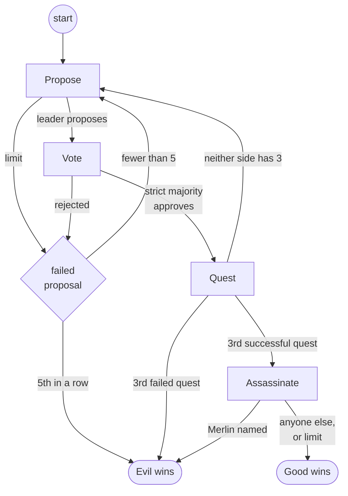

# ADR-0010: Avalon is a second game, built by copying Werewolf

**Status:** Proposed
**Date:** 2026-10-12
**Deciders:** Bill McNeill
**Depends on:** [ADR-0001](0001-games-and-variants-are-modules-and-subcommands.md),
[ADR-0002](0002-actors-perceive-think-and-act.md),
[ADR-0003](0003-the-model-player.md),
[ADR-0004](0004-the-model-is-asked-to-select-before-a-game.md),
[ADR-0005](0005-actors-talk-by-sending-messages-alone.md),
[ADR-0006](0006-players-talk-by-day.md),
[ADR-0007](0007-a-tool-call-is-required-where-the-model-allows-it.md),
[ADR-0008](0008-werewolf-players-are-dealt-strategies.md),
[ADR-0009](0009-only-a-change-of-decision-restarts-the-ratify-timer.md)
**Amends:** [ADR-0008](0008-werewolf-players-are-dealt-strategies.md)

## Context

The `social-deduction` crate plays one game, Werewolf, as one subcommand
whose players are dealt *strategies* ([ADR-0008](0008-werewolf-players-are-dealt-strategies.md)):
a `random` or `prompted` policy with its parameters, allotted to each
role's seats by a TOML file. An announcing environment opens each phase
with a `View` for every living player, takes their selections, and ends
the phase. Prompted players talk by day ([ADR-0006](0006-players-talk-by-day.md)),
and the day's vote is ratified ([ADR-0009](0009-only-a-change-of-decision-restarts-the-ratify-timer.md)).

The next game is *The Resistance: Avalon*. It is less asynchronous than
Werewolf, since most of its decisions are simultaneous and secret, but
psychologically much richer: every proposal, vote and quest result is
evidence about hidden roles, and the chains of "if they were Merlin, why
would they…" run deep. It also has public data to check against: ProAvalon's
logs of human games, and DeepRole's win rates for a model that does not
talk.

There will be plenty of code the two games could share. The project's rule
against building generality before it is needed says not to guess at it.
Avalon is built first, by imitating Werewolf as closely as its rules allow,
and only once both games work is the common code factored out. Two working
games side by side show where the seams really are; one game and a guess do
not.

Some of what Werewolf has is already free of anything Werewolf-specific:
player ids and routing, how seats are named in a story, models and how to
reach them, strategies and policies. Copying those would make two copies of
code that is already general, and would hide them among the copies that
differ.

## Decision

**Avalon is a game of its own, a module beside `werewolf` in
`social-deduction` and a subcommand beside `werewolf`, built by copying
Werewolf and editing the copy. Whatever Werewolf has that would compile
unchanged for Avalon is first moved out of `werewolf` to a shared module at
the crate root, and both games import it from there. Nothing in `avalon`
imports from `werewolf`.**

### What is shared and what is copied

The rule is mechanical: an item that compiles unchanged for both games
moves to the crate root; an item that needs any edit is copied into
`avalon/` and edited. The shared modules are then the list of what is
already general, and comparing `werewolf/` with `avalon/` file by file is
the list of seams for the later refactoring.

The move is a refactoring of Werewolf alone, done before any of Avalon, and
changes nothing about how Werewolf plays or what it logs.

| Moves to | What |
|---|---|
| `seat.rs` | `PlayerId`, `ENVIRONMENT`, `to_the_environment`, `to_the_players_but`, `to_everyone_but` |
| `report.rs` | `Seat`, `seat_order`, `numbered`, `in_order`, `listed`, `whole_seconds`, made `pub(crate)` |
| `strategy.rs` | the policies, the `[strategies.<name>]` tables and their parsing, the built-in `random` strategy |
| `model/spec.rs` | the `[models.<name>]` table, renamed `Spec`, with `api_key`, `key_variable`, `provider` and the request timeout; setting up the models in play from their names |
| `model/window.rs` | `ContextWindow`, `Source`, and settling a model's window from its table, its listing, `src/models.toml` or the code |

The `[models.<name>]` table's type is renamed from `Model` to `model::Spec`,
since inside `model` it would collide with the `Model` trait. It describes a
model and how to reach it, not the model.

What stays in each game, because it names a `Role` or a `Message`: the
deal of (role, strategy) pairs, the check of a model's context window
against the largest request the game can make, the probe, `act`,
`observe`, the prompted player's `Mind` and its `Story`, and the
`Narrator`.

### Layout

```
apps/social-deduction/
  examples/
    werewolf/random.toml, prompted.toml
    avalon/random.toml, prompted.toml
  src/
    lib.rs
    seat.rs
    report.rs
    strategy.rs
    model.rs
    model/
      canned.rs, completion.rs, fake.rs
      spec.rs
      window.rs
    werewolf.rs
    werewolf/
      config.rs, announced.rs, random.rs, prompted.rs, report.rs
    avalon.rs          # the rules, roles, State, View, Message, Entry, Actor, game
    avalon/
      config.rs        # the file, the command line overrides, the settings, the deal
      announced.rs     # the environment
      random.rs        # the random policy
      prompted.rs      # the prompted policy
      report.rs        # the Narrator and the Story
```

### The rules

Avalon is played by 5 to 10 players on two teams, good and evil, over at
most five quests. Each quest is led by a leader, who proposes a team; every
player votes on it; if it is approved, its members go on the quest, and
each one either supports or sabotages it. Good wins with three successful
quests, unless the Assassin then names Merlin. Evil wins with three failed
quests, five failed proposals in a row, or Merlin named.



Every box is a phase, numbered by `seq` in one series from 1 as Werewolf's
are, opened with an `Announce` to every player and ended at its limit if
not before.

- **Propose.** The leader proposes a team of the size the quest needs, and
  may include itself. The phase ends when it does. If it reaches its limit
  first, the proposal has failed, exactly as a rejected one has.
- **Vote.** Every player approves or rejects the proposed team. The votes
  are secret until the phase ends, and each player's first vote is final.
  The phase ends when everyone has voted, or at its limit. The team is
  approved when the approvals are a strict majority of all the players:
  twice the approvals is more than the number of players. A player who did
  not vote did not approve.
- **Failed proposals.** A proposal fails when the vote rejects it or the
  leader lets the phase run out. Five failed proposals in a row win the
  game for evil. A quest that goes, whatever its result, starts the count
  over.
- **Quest.** Each member of the team supports or sabotages it, in secret.
  The phase ends when every member has, or at its limit; a member who did
  neither supported it. The quest fails when the sabotages reach the
  number it needs, which is 1, except 2 on the fourth quest with 7 or more
  players. Only how many sabotaged it is told, not who.
- **Assassinate.** After the third successful quest, the Assassin names one
  player as Merlin. Naming Merlin wins for evil; naming anyone else, or
  naming nobody by the limit, wins for good. A game with no Merlin, and so
  no Assassin, goes straight to good's win.
- **Leaders.** `player1` leads the first proposal, and the lead passes in
  seat order, wrapping around, after every proposal, whatever became of it.
  The roles are dealt at random, so choosing the first leader at random as
  well would add nothing.
- **Talk.** Every player may speak in every phase. There is no night and
  nobody is voted out, so nobody sleeps and nobody dies. Players are
  stopped only when the game ends.

A team's size depends on the number of players and the quest:

| Players | Quest 1 | Quest 2 | Quest 3 | Quest 4 | Quest 5 |
|---|---|---|---|---|---|
| 5 | 2 | 3 | 2 | 3 | 3 |
| 6 | 2 | 3 | 4 | 3 | 4 |
| 7 | 2 | 3 | 3 | 4 (2 sabotages) | 4 |
| 8–10 | 3 | 4 | 4 | 5 (2 sabotages) | 5 |

Nothing in Avalon is ratified. There is no `Tentative`, no ratify timer,
and no `Retract`: every decision is final when it is made, as by night in
Werewolf, and a player who wants to talk first does so before it acts, as
by an unratified day in Werewolf.

### Roles and what each sees

```rust
pub enum Team { Good, Evil }
pub enum Role { Merlin, Percival, Servant, Assassin, Morgana, Mordred, Oberon, Minion }
pub enum Seen { Evil, MerlinOrMorgana }
```

Merlin, Percival and the Servants (loyal servants of Arthur) are good; the
Assassin, Morgana, Mordred, Oberon and the Minions (of Mordred) are evil.
Knowledge in Avalon is of teams, not roles, so a player is shown its own
role and what it sees of some others:

| Role | Sees |
|---|---|
| Merlin | every evil player but Mordred, as `Evil` |
| Percival | Merlin and Morgana, as `MerlinOrMorgana` |
| Evil, but Oberon | every other evil player but Oberon, as `Evil` |
| Oberon, Servant | nobody |

Roles otherwise differ only in what they may do: the Assassin names Merlin,
and only evil players may sabotage.

A table is valid when it has 5 to 10 players, at most one of each role but
Servant and Minion, and a Merlin exactly when it has an Assassin. Any other
table is an error at startup, naming what is wrong. The split between the
teams is not checked. The usual splits are 3–2, 4–2, 4–3, 5–3, 6–3 and 6–4
for 5 to 10 players, and the README says so.

The default table is Merlin, the Assassin, two Servants and one Minion.

### Types

```rust
pub enum Phase { Propose, Vote, Quest, Assassinate }
pub enum Ballot { Approve, Reject }
pub enum Deed { Support, Sabotage }

pub struct Tally {
    pub ballots: HashMap<PlayerId, Ballot>,   // a player who did not vote is absent
    pub approved: bool,
}

pub struct QuestResult {
    pub team: Vec<PlayerId>,
    pub sabotages: usize,
    pub succeeded: bool,
}

pub struct View {
    quest: NonZero<u8>,              // 1..=5
    proposal: NonZero<u8>,           // 1..=5: failed proposals in a row, plus one
    phase: Phase,
    leader: PlayerId,
    size: usize,                     // the team the quest needs
    sabotages_needed: usize,         // 1, or 2 on the fourth quest with 7 or more players
    team: Option<Vec<PlayerId>>,     // the proposed team, in Vote and Quest
    tally: Option<Tally>,            // the vote that just ended, in the phase after it
    record: Vec<QuestResult>,        // every quest so far
    role: Role,
    sees: HashMap<PlayerId, Seen>,
    players: Vec<PlayerId>,
}
```

A player's choice is a `Deed`, not a "card" or a "success" or "fail": a
player supports or sabotages, and it is the quest that succeeds or fails.

**Results reach players only in the next phase's `View`.** The team being
voted on, the tally of the vote just ended, and the record of every quest
are all in the `View` that each `Announce` carries, as a death reaches a
Werewolf player in `alive`. The environment is the only source of public
facts, and no message narrates what a `View` already shows. Since the
record is in every `View`, a prompted player that forgets old talk to fit
its context window never forgets a team, a vote or a quest result.

### Messages

```rust
pub enum Message {
    Announce { seq: u64, n: u64, view: View, limit: Duration },
    Propose  { seq: u64, from: PlayerId, n: u64, team: Vec<PlayerId> },
    Vote     { seq: u64, from: PlayerId, n: u64, ballot: Ballot },
    Perform  { seq: u64, from: PlayerId, n: u64, deed: Deed },
    Select   { seq: u64, from: PlayerId, n: u64, target: PlayerId },
    Say      { seq: u64, from: PlayerId, n: u64, text: String },
    EndPhase { seq: u64 },
    Wake,
    Remind   { seq: u64, count: u64 },
}
```

| Message | From | To |
|---|---|---|
| `Announce` | environment | every player |
| `Propose` | the leader | the environment |
| `Vote` | a player | the environment |
| `Perform` | a member of the team | the environment |
| `Select` | the Assassin, naming Merlin | the environment |
| `Say` | a player | every other player |
| `EndPhase` | environment | itself |
| `Wake`, `Remind` | a prompted player | itself |

Numbering, `seq` and `n`, phase tags on `Say`, and what is a message to
oneself are as in Werewolf. `Select` keeps Werewolf's name for naming one
player. Only `Say` goes from player to player.

### The environment

`avalon/announced.rs` is Werewolf's announcing environment, copied: a
`Game` shared by the perceive loop and the think loop, with `open`,
`choose`, `end` and `conclude`, and an `EndPhase` reminder at each phase's
limit. What each phase collects is a `Choice`:

```rust
enum Choice { Team(Vec<PlayerId>), Ballot(Ballot), Deed(Deed), Target(PlayerId) }
type Choices = HashMap<PlayerId, Choice>;
```

**The players the environment waits on are `awaited`, not `awake`.** In
Werewolf the two coincide: by night only the awake act and talk, and by
day everyone does both. In Avalon everyone hears and talks in every phase,
but the environment waits only on the leader, every player, the team, or
the Assassin. The name changes because the concept does, and the change
marks a seam.

**The environment checks that a choice is legal.** Werewolf's environment
trusts its players' targets. Avalon's counts a choice only if:

- it is of the kind the phase takes, in the phase underway, from a player it
  awaits, and that player's first;
- a team is the size the quest needs, of distinct players;
- a `Sabotage` comes from an evil player;
- the Assassin's target is another player, and not one it sees as evil.

A choice that is not legal is treated like a stale one: logged as observed,
and nothing more. Players still cooperate with the rules, and the players
this decision builds never make an illegal choice. The check is there
because a sabotage by a good player would change the outcome silently,
and because a replay of logged human games through the environment is
only a test of the rules if the environment enforces them.

### The random policy

A random player answers each `Announce` that awaits it at once, with a
choice made uniformly at random among the legal ones. The leader proposes
a team drawn uniformly from all the teams of the right size, itself
included. Each vote approves or rejects with even odds. A good member
supports; an evil member supports or sabotages with even odds. The Assassin
names one of the players it does not see as evil. Otherwise it observes,
as Werewolf's does.

### The prompted policy

The prompted player is Werewolf's, copied, without its night. Every
message tagged with the phase it is in wakes it, debounced as in Werewolf,
since in every phase it may talk. A response's calls are carried out in
order, a call that ends in a later phase than it began is withheld, a
response that is not well formed is a failure, and `wait` sets a
reminder, all as in Werewolf.

Every request offers `speak` and `wait`. A player the phase awaits is also
offered one of:

| Phase | Who | Tool |
|---|---|---|
| Propose | the leader | `propose(team)`: an array of distinct seats, exactly as many as the quest needs |
| Vote | every player | `vote(approve)`: a boolean |
| Quest | each member of the team | `perform(deed)`: `support` for good players; `support` or `sabotage` for evil |
| Assassinate | the Assassin | `select(target)`: one of the players it does not see as evil |

As for a Werewolf day without a ratify limit ([ADR-0008](0008-werewolf-players-are-dealt-strategies.md)),
the tool is offered again after the player has used it, and a second use
is sent and does not count. A `propose` call naming the wrong number of
players, or the same player twice, makes the response a failure, and the
leader's phase may then run out.

The situation that ends each request says which quest it is and which
proposal of five, who leads, how big the team must be and how many
sabotages fail it, how long the phase lasts, and what is asked of the
player.

**The probe** ([ADR-0004](0004-the-model-is-asked-to-select-before-a-game.md),
[ADR-0007](0007-a-tool-call-is-required-where-the-model-allows-it.md))
asks each model in play four times, once for each phase, as the player the
phase awaits: as the leader, as a voter, as an evil member of a team, and
as the Assassin. Each phase brings a tool of a new shape, and the array in
`propose` is the one most likely to trip a small model.

A prompted strategy's template is rendered as in Werewolf, with `name`,
`role` and every `[text]` block.

### Configuration and the command line

`avalon/config.rs` is Werewolf's, copied, with Avalon's roles and limits,
and using the shared `[models]` and `[strategies]`. A file with nothing in
it plays the default table with random players.

```toml
[strategies.schemer]
policy = "prompted"
model = "qwen"
system = """{{ rules }}

You are {{ name }}, {{ role }}."""

[roles.merlin]
strategy = "schemer"

[roles.servant]
count = 3

[roles.minion.strategies]
random = 1
schemer = 1
```

The roles' tables are `merlin`, `percival`, `servant`, `assassin`,
`morgana`, `mordred`, `oberon` and `minion`. The limits are
`propose_limit`, `vote_limit`, `quest_limit` and `assassinate_limit`, each
60 seconds by default. There is no `ratify_limit`, and like any unknown key
it is an error.

```sh
social-deduction avalon [CONFIG] [--merlin N] [--percival N] [--servants N] [--assassin N] [--morgana N] [--mordred N] [--oberon N] [--minions N] [--propose-limit D] [--vote-limit D] [--quest-limit D] [--assassinate-limit D] [--log | --no-log]
```

Eight counts on the command line is a lot. They mirror Werewolf's for now.

### The actor

```rust
pub enum Actor {
    Environment(announced::Environment),
    Random(random::Player),
    Prompted(prompted::Player),
    #[cfg(test)]
    Puppet(tests::Puppet),
}
```

`avalon::game` builds the episode as `werewolf::game` does. Every player
may send to the environment and to every other player.

### The log

`Entry::Configuration`, `Action`, `Observation`, `Withheld` and `Failed`
are Werewolf's. The rest are Avalon's:

```rust
pub enum Entry {
    Start { roles, strategies, propose_limit, vote_limit, quest_limit, assassinate_limit },
    // Configuration, Action, Observation, Withheld, Failed as in Werewolf
    Proposed     { seq: u64, team: Option<Vec<PlayerId>> },     // None: the leader ran out of time
    Tallied      { seq: u64, tally: Tally },
    Quested      { seq: u64, result: QuestResult },
    Assassinated { seq: u64, target: Option<PlayerId>, merlin: bool },
    End          { winner: Team, by: Victory, took: Duration },
}

pub enum Victory { Quests, Sabotage, Rejections, Assassination }
```

Every phase ends with exactly one of `Proposed`, `Tallied`, `Quested` or
`Assassinated`, as Werewolf's end with `Hunted` or `Voted`.

### Narration

`avalon/report.rs` has a `Narrator`, for the whole game from the log, and
a `Story`, for one player from its memory, in the two voices Werewolf's
have, using the shared seat helpers. The `Narrator` opens with the table,
each player's role and strategy, and tells each phase as it opens and
ends: who leads, who is proposed, how everyone voted, how many sabotaged.
A player's story opens with its role and what it sees.

### Tests

The environment is tested phase by phase with puppet players, as
Werewolf's is. In addition, the all-random game is a small Markov chain,
so the good team's chance of winning can be computed exactly. A test plays
many all-random games of the default table and checks the win rate against
it. For tables of Merlin, the Assassin, Servants and Minions in the usual
splits it is:

| Players | 5 | 6 | 7 | 8 | 9 | 10 |
|---|---|---|---|---|---|---|
| Good wins | 0.333 | 0.250 | 0.377 | 0.234 | 0.407 | 0.234 |

The sawtooth is the strict majority: a random team is approved half the
time with 5 players but 22 times in 64 with 6.

### Order of work

1. Move the shared items out of `werewolf`, renaming `Model` to
   `model::Spec`. Werewolf plays and logs as before.
2. Avalon with random players: the rules, the environment, the random
   policy, the narration, and `social-deduction avalon` with the command
   line and no file. A game can be watched.
3. The configuration file, with random strategies.
4. The prompted policy and its probe, and the examples.

## Alternatives considered

### Factor out the common code first

A generic announcing environment, or a game trait, would let both games
share their machinery. With one game, its shape would be a guess, and
undoing a wrong guess costs more than merging two copies. Rejected for now;
it is what the copies are for.

### Copy everything

Copying even what compiles unchanged would make Avalon independent of
Werewolf with no move at all. It would also leave two copies of model
specs, context windows, strategies and seat helpers that could never
differ, mixed in with the copies that do. Rejected.

### Import from `werewolf`

Avalon could use the general items where they are. That would make one
game depend on another, and the dependency would have to be undone later.
Rejected.

### Public votes, ratified

The vote could be Werewolf's day: public as cast, changeable, with a
tentative decision and a ratify timer. It would keep Avalon as asynchronous
as Werewolf, and reuse the most interesting machinery the project has.
Avalon's votes are secret and simultaneous, and a replay of human games
only tests the rules if the rules are Avalon's. Deferred as a variant of
its own.

### Results as messages of their own

The environment could send a tally and a quest result as messages of their
own. They would repeat what the next `View` shows, and the project has
already removed such narration from Werewolf.

### A random team when the leader runs out of time

The environment could propose a random team for a leader that does not.
Counting it as a failed proposal is simpler, needs no randomness in the
environment, and is the same rule as a Werewolf villager who fails to vote
in time and loses its vote.

### Trust the players' choices

Werewolf's environment does. Rejected for Avalon, for the reasons above.

### Fewer roles

Merlin, the Assassin, Servants and Minions are enough to play. The other
four differ only in what they see, which is one table, so all eight come at
once.

### A random first leader

Equivalent to `player1`, since roles are dealt at random.

### `Card { Success, Fail }`

The board game's word for a player's choice. A player supports or
sabotages; a quest succeeds or fails.

## Consequences

- `social-deduction` plays two games, from one crate, with any mix of
  random and prompted strategies and models in each.
- **ADR-0008 is amended:** the `[models]` table's type is `model::Spec`,
  and the models, strategies and their parsing live at the crate root, not
  in `werewolf/config.rs`.
- Shared code is the crate root; everything else in each game is a copy of
  the other's. Each change to one game's copy has to be weighed for the
  other until they are merged.
- Avalon has none of Werewolf's ratification. Its asynchrony is in its
  talk alone.
- An Avalon game has many more phases than a Werewolf game, from 9 to 56,
  with talk in every one. A prompted table makes several times the
  calls a Werewolf table does.
- Avalon's environment enforces its rules; Werewolf's trusts its players.
  The difference is deliberate, and is one more thing to settle when they
  merge.

## Deliberately deferred

1. Factoring out the code the two games share.
2. Summarizing old conversation instead of forgetting it, to fit a context
   window, in both games.
3. The Lady of the Lake and other optional rules.
4. A variant with public, ratified votes.
5. Replaying ProAvalon's logged games through the environment.
6. Choosing a usual table by the number of players alone, such as
   `--players N`.
