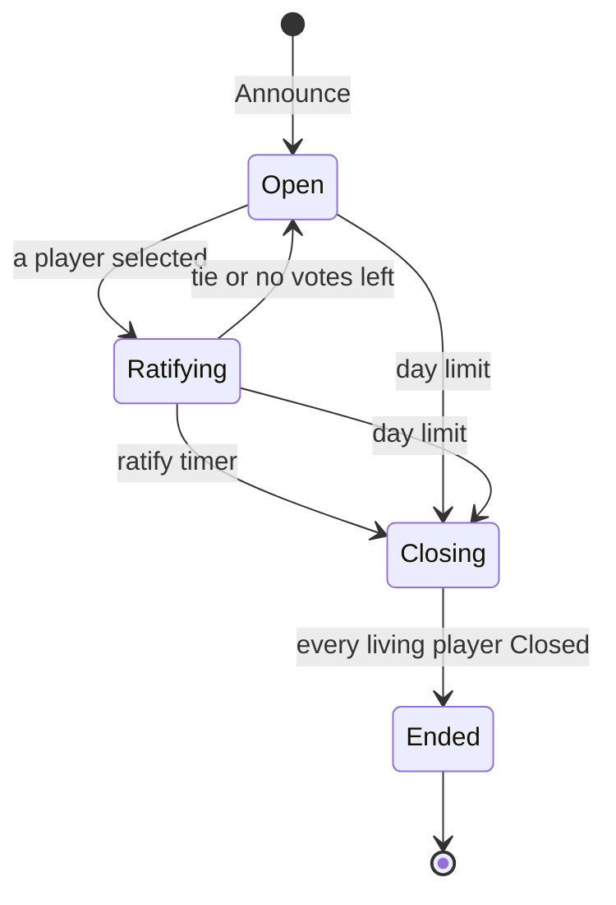

# ADR-0011: Speech is never cut off at a phase end

**Status:** Proposed
**Date:** 2026-10-14
**Deciders:** Bill McNeill
**Depends on:** [ADR-0003](0003-the-model-player.md),
[ADR-0006](0006-players-talk-by-day.md),
[ADR-0009](0009-only-a-change-of-decision-restarts-the-ratify-timer.md),
[ADR-0010](0010-avalon-is-a-second-game-built-by-copying-werewolf.md)
**Amends:** [ADR-0006](0006-players-talk-by-day.md),
[ADR-0009](0009-only-a-change-of-decision-restarts-the-ratify-timer.md)

## Context

A phase ends the moment the environment decides it is over. In Werewolf
that is at the phase limit, when the ratify timer fires
([ADR-0009](0009-only-a-change-of-decision-restarts-the-ratify-timer.md)),
or when everyone awake has selected. In Avalon it is when the leader
proposes, everyone has voted, the team has acted, the Assassin has named
someone, or the phase limit runs out. Either way, the environment announces
the outcome and the next phase at once.

A prompted player calls its model in its think loop, while it keeps
perceiving ([ADR-0003](0003-the-model-player.md)), and a call takes
seconds. When the model answers, the player checks that the phase the call
began in is still the one it was last announced. If a newer phase has
been announced in the meantime, the player sends nothing: it logs each
message it would have sent, speech included, as `Withheld`. Both games
share this player.

So every phase end throws away the words of whoever was mid-call. By day
in Werewolf that is most of the table. In Avalon, where the phases are
short and follow each other quickly, it happens all game long. In the
desktop viewer these show up as a stream of faded "too late, never sent"
bubbles. The players are not slow. The rules simply give them no way to
finish a sentence that was already on its way.

The two games need different answers, because their talk is different:

- **Werewolf's talk belongs to the day.** Players speak only by day, and
  never at night ([ADR-0006](0006-players-talk-by-day.md)). A day's last
  words must land before the night falls, and before the day's outcome is
  told.
- **Avalon's talk belongs to the game.** Anyone may talk in every phase
  ([ADR-0010](0010-avalon-is-a-second-game-built-by-copying-werewolf.md)).
  Avalon is a chat that stays open for as long as the game is played, and
  the phases are only what the table is deciding at the moment.

Choices are a different matter. A vote, selection, proposal or deed
belongs to the phase it was made for, and must never count in another.

## Decision

**No speech is withheld because a phase ended.**

- **Werewolf:** before a phase ends, it closes. The environment fixes the
  outcome, tells every living player the phase is closing, and waits until
  each has finished what it was already saying. Only then does it announce
  the outcome and the next phase. No choice can be made while a phase
  closes.
- **Avalon:** speech is not tied to a phase. A player sends what its model
  said whenever the model answers, whatever phase the game has reached.

In both games, a *choice* from a call that began in a phase that has since
ended (or, in Werewolf, begun closing) is still withheld and logged as
`Withheld`, as today.

### The shared player: speech is sent, stale choices are withheld

When a call's answer arrives, the shared prompted player carries it out
as follows:

- **Speech** (`Say`) is sent, whatever phase the player was last
  announced. It is tagged with the latest phase the player was announced
  when it sends the speech, which is how speech is tagged today ("the phase
  as the speaker knew it").
- **A choice** (Werewolf's `Select` and `Retract`; Avalon's `Propose`,
  `Vote`, `Perform` and `Select`) is sent only if the phase the call began
  in is still the player's latest. In Werewolf, the phase must also not be
  closing. Otherwise the choice is logged as `Withheld` and not sent.
- **A reminder** the answer asks for is set only if the call's phase is
  still the latest, as today.

In Werewolf this rule and closing fit together: closing guarantees that no
call is in flight when a phase ends, so the "whatever phase" case never
arises.

### Werewolf: closing

Every way a Werewolf phase ends, by night or by day, begins closing:

- the phase limit;
- the ratify timer;
- everyone awake having selected, in a night, or in a day without a ratify
  limit.

When one of these happens, the environment:

1. **Fixes the outcome.** It decides the phase as it would today, from the
   choices counted so far: whom the werewolves kill and who is protected,
   or who is voted out, if anyone. It does not log or announce the outcome
   yet.
2. **Sends `Closing`** to every living player.
3. **Waits** for a `Closed` from every living player.
4. **Ends the phase** as it does today. It logs the outcome (`Hunted` or
   `Voted`), then announces the next phase or ends the game.

| Message | From | To | Carries |
|---|---|---|---|
| `Closing` | environment | every living player | `seq`, `n` |
| `Closed` | a player | the environment | `seq`, `from`, `n` |

Both are numbered in the sender's own series and tagged with the phase
that is closing, like every other message. Neither is a choice. The time a
phase spends closing is not part of its limit.

**No choices while closing.** From the moment a phase begins closing,
nothing can change its outcome. The players keep this rule themselves, as
they keep every rule of the game: a player that has received `Closing`
makes no choice for the phase. It sends no `Select` or `Retract`, by day or
by night, and starts no model call that could produce one (see *What a
player does*). If the model call it already had in flight answers with a
choice, the player does not send it. It logs it as `Withheld`, the record
of what the model would have done.

The environment checks too, in case a player does not cooperate or a
choice was already on its way when `Closing` went out. It counts no
`Select` or `Retract` for a closing phase: it logs observing one, and
nothing else happens, as with a selection for an ended phase today. The
ratify timer is not running, and no `Tentative` is sent while a phase
closes. The same holds by night: a werewolf's, doctor's or seer's
selection does not count once the night has begun closing.

**What a player does.** A player that receives `Closing` for the phase it
is in:

- **Starts no new model call** for the phase. A wake-up or reminder still
  waiting for that phase is dropped.
- **Finishes the call it has in flight, if any.** When the model answers,
  the player sends the speech and withholds any choice, as the shared rule
  says.
- **Replies `Closed`** once it has no call in flight for the phase. That
  is at once if it had none, or right after carrying out the answer, or the
  failure, of the call it had.

A uniform-random player, which never calls a model, replies `Closed` at
once. Speech sent while a phase closes is ordinary speech: it goes to every
other living player, tagged with the closing phase. A model player woken by
it does not call its model, since the phase is closing.

**How long a phase can close.** There is no closing timer. A phase closes
when the slowest call in flight returns, and every model call answers or
fails within its model's request timeout (`request_timeout` in the model's
spec). A player that dies is not waited for, and nobody dies while a phase
closes.

**The day**, from
[ADR-0009](0009-only-a-change-of-decision-restarts-the-ratify-timer.md),
gains a state between the decision and the end:

| Transition | The environment |
|---|---|
| Ratifying → Closing, ratify timer | fixes the outcome: the selected player is voted out; sends `Closing` to every living player |
| Open or Ratifying → Closing, day limit | fixes the outcome: nobody is voted out; sends `Closing` to every living player |
| Closing → Closing, speech | nothing; speech goes to the players as usual |
| Closing → Closing, `Closed` | notes the player as closed |
| Closing → Closing, a choice | logs observing it; it does not count |
| Closing → Ended | logs `Voted` with the fixed outcome, announces the next phase or ends the game |

The night is the same, with the night's own endings (everyone awake has
selected, or the night limit) and `Hunted` as its outcome.

This amends [ADR-0006](0006-players-talk-by-day.md)'s day, which ends
immediately, and
[ADR-0009](0009-only-a-change-of-decision-restarts-the-ratify-timer.md)'s
ratify timer, which now begins the day's closing rather than ending the
day.

### Avalon: the chat stays open

Avalon's environment does not change. It ends phases exactly as it does
today. Only the shared player's rule above changes what reaches the table:
a speech that arrives after the phase it began in has ended is sent to
every other player and heard, and is told in the story with everything
else. A model player woken by speech in a later phase calls its model in
that phase, as it would for any speech.

The game's end is the one boundary speech does not cross. When Avalon ends,
the environment stops every player, and a call still in flight then is
dropped, as today.

### The model player

Nothing changes in what a model is asked or offered. In Werewolf a model
is never called while a phase closes, so `Closing` never reaches a prompt,
and the player's story does not tell it. In Avalon a model sees speech that
crossed a phase boundary in its history like any other speech.

### Narration and the viewer

- **Werewolf console narration** gets one new line: "Day 2 is closing."
  (or "Night 2 is closing.") when the phase begins closing. The outcome is
  told when the phase ends, after any speech made while it closed.
- **Avalon narration** tells speech as it comes, as today. Speech from an
  earlier phase is simply told in order, in the phase in which it arrives.
- **The viewer's header** shows "Closing…" in Werewolf from the
  environment's `Closing` until the next `Announce`. The thinking dots of
  players still finishing stay up until their calls return.

### Logging

The log gains nothing but Werewolf's two messages. `Closing` and `Closed`
are `Action`s of their senders and `Observation`s of their receivers, as
every message is, and the log gains them by gaining the variants. How long
each phase spent closing can be read from the log: from the environment's
first `Closing` action to the next `Announce`. `Withheld` is now logged
only for choices.

## Alternatives considered

### A fixed grace period

After a phase ends, keep accepting speech for a few seconds. Rejected:
it needs a number that is either too short for a slow model or too long
for a fast one, and it still cuts off a call that runs past it. In
Werewolf, waiting for the calls actually in flight wastes no time and cuts
off nobody. In Avalon there is nothing to wait for.

### Let choices count while closing

Keep counting votes until the last player has closed. Rejected: it reopens
a decision after it was made, and with it the ratify timer, so the day
could close, reopen and close again. Closing is only for finishing words.

### Players report thinking to the environment

Have each player tell the environment when every model call starts and
ends, so the environment always knows who is mid-call. Rejected: it sends
two messages per call all game long, for something that matters only at
the end of a phase, and it makes the environment track players' thinking.
Asking once, at the end, is enough.

### Werewolf speech crosses phases, as Avalon's does

Rejected: a day's last words would arrive after the night's announcement,
or after the day's outcome, when wolves don't talk and the dead hear
nothing. Werewolf's talk belongs to the day.

### Close Avalon's phases too

Rejected: Avalon's talk belongs to the game, not the phase. Closing would
hold up every quick phase in order to protect speech that has no reason to
stop at the phase boundary.

### Stop withholding choices too

Rejected: a vote, selection, proposal or deed made for one phase would
count in the next.

## Consequences

- **No speech is cut off by a phase end** in either game. `Withheld` now
  covers only choices made too late.
- **The viewer's late speech goes.** Its faded "too late, never sent"
  bubble could no longer appear, so the code behind it is removed:
  - the `Beat::Late` cue;
  - the `Stage`'s handling of a withheld utterance;
  - the frontend's late bubble and its `.sd-late` style;
  - the e2e check's assertion for it, and the late utterance in the recorded
    Werewolf fixture's expectations.

  A withheld choice still gives no cue, as before.
- **Werewolf phases take longer than their limits** by up to the slowest
  call in flight. The extra time shows in the log as the gap between
  `Closing` and the next `Announce`.
- **In Werewolf the outcome is fixed before the last speech,** so words
  spoken while a phase closes cannot change it. A player may still say
  something revealing on its way out.
- **A Werewolf model call that never returned would hold the game** until
  it timed out. Every call has a request timeout, so the wait is bounded,
  but not by anything in this ADR.
- **In Avalon, speech can arrive a phase late.** A remark about the last
  proposal may land while the next leader is choosing a team, as it would
  in a real chat.
- **Werewolf's message enum gains `Closing` and `Closed`.** Random players
  answer `Closing` at once.
- **The shared player's rule changes.** Speech is never withheld at a phase
  boundary, and choices still are.

## Deliberately deferred

1. **A cap on closing,** should a provider's request timeout ever prove too
   long to wait.
2. **Speech that crosses the end of an Avalon game,** which is still
   dropped when the players are stopped.
